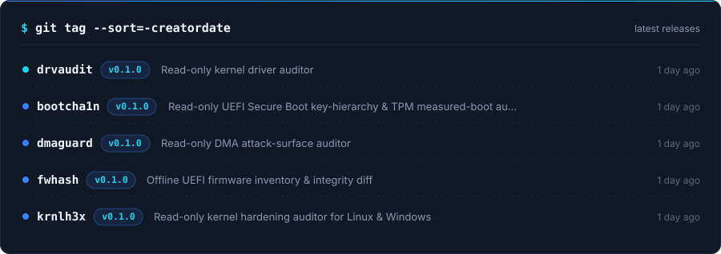
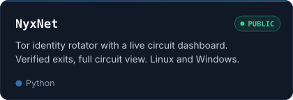
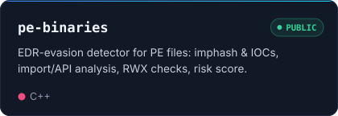
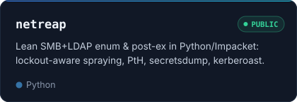
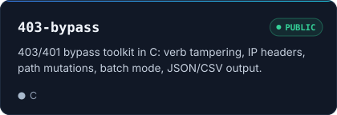
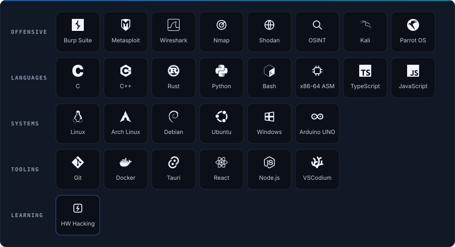
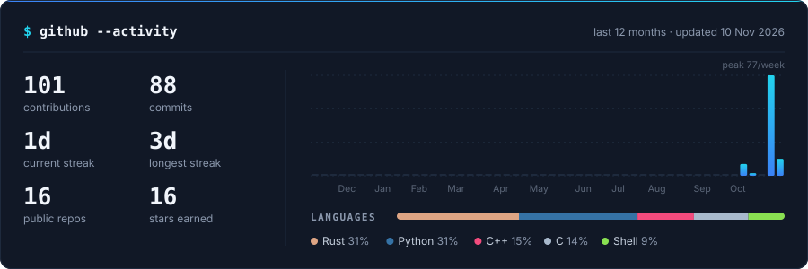

  

  
  

<table>
<tr>
<td width="62%" valign="top">

### whoami

Offensive security engineer focused on **pentesting, automation and low-level tooling**. I build my own tools in **C/C++, Rust, Python and Bash**, from USB and Wi-Fi auditing on the terminal to hardened Linux setups and AI-assisted security.

Right now I'm building **NetSentry**, a modular recon suite, and **Aegis**, an AI security copilot, while going deeper into **hardware hacking**.

</td>
<td valign="top">

### quick facts

📍 &nbsp;Melbourne, Australia 
🎓 &nbsp;Cert IV in Cyber Security 
🏢 &nbsp;Founder, [CentralTech](https://centraltechpc.com) 
🎯 &nbsp;Pentest · Recon · Exploit dev 
🔌 &nbsp;Learning hardware hacking

</td>
</tr>
</table>

## Featured · usbscope

<table>
<tr>
<td width="60%" valign="top">

</td>
<td valign="top">

**Interactive USB inspector for the Windows terminal.**

- Walks every controller and hub through hub IOCTLs, with no driver install
- Decodes device, config, interface and endpoint descriptors, with raw hex side by side
- Flags suspicious devices: HID keyboard + storage, exposed DFU/serial, missing serials
- C++17, zero dependencies, a single `.exe`

[**→ View repository**](https://github.com/grimh3xx/usbscope)

</td>
</tr>
</table>

<b>More demos:</b> samcli · aircrackwin-x64

 

aircrackwin-x64 in demo mode with simulated networks. Only audit networks you own or are authorized to test.

## Latest releases

  <picture><source media="(prefers-color-scheme: light)" srcset="assets/releases-light.svg"/></picture>

## Projects

  <a href="https://github.com/grimh3xx/samcli-win-x64"><picture><source media="(prefers-color-scheme: light)" srcset="assets/card-samcli-light.svg"/></picture></a>
  <a href="https://github.com/grimh3xx/aircracking-win-x64"><picture><source media="(prefers-color-scheme: light)" srcset="assets/card-aircrack-light.svg"/></picture></a>
  <a href="https://github.com/grimh3xx/SecureArchSetup"><picture><source media="(prefers-color-scheme: light)" srcset="assets/card-securearch-light.svg"/></picture></a>
  <a href="https://github.com/grimh3xx/ExifTracer"><picture><source media="(prefers-color-scheme: light)" srcset="assets/card-exiftracer-light.svg"/></picture></a>
  <a href="https://github.com/grimh3xx/NyxNet"><picture><source media="(prefers-color-scheme: light)" srcset="assets/card-nyxnet-light.svg"/></picture></a>
  <a href="https://github.com/grimh3xx/pe-binaries"><picture><source media="(prefers-color-scheme: light)" srcset="assets/card-pebinaries-light.svg"/></picture></a>
  <a href="https://github.com/grimh3xx/netreap"><picture><source media="(prefers-color-scheme: light)" srcset="assets/card-netreap-light.svg"/></picture></a>
  <a href="https://github.com/grimh3xx/403-bypass"><picture><source media="(prefers-color-scheme: light)" srcset="assets/card-bypass403-light.svg"/></picture></a>
  <picture><source media="(prefers-color-scheme: light)" srcset="assets/card-netsentry-light.svg"/></picture>
  <picture><source media="(prefers-color-scheme: light)" srcset="assets/card-aegis-light.svg"/></picture>
  <picture><source media="(prefers-color-scheme: light)" srcset="assets/card-winforge-light.svg"/></picture>
  <picture><source media="(prefers-color-scheme: light)" srcset="assets/card-cts-light.svg"/></picture>

## Certification

  <picture><source media="(prefers-color-scheme: light)" srcset="assets/cert-light.svg"/></picture>

<!--CTF:START-->
<!--CTF:END-->

## Stack

  <picture><source media="(prefers-color-scheme: light)" srcset="assets/skills-light.svg"/></picture>

## Activity

  <picture><source media="(prefers-color-scheme: light)" srcset="assets/activity-light.svg"/></picture>

<!--ACTIVITY:START-->
- 🔨 Pushed to [**403-bypass**](https://github.com/grimh3xx/403-bypass) · 11 hours ago
- 🔨 Pushed to [**pe-binaries**](https://github.com/grimh3xx/pe-binaries) · 11 hours ago
- ⭐ Starred [**netreap**](https://github.com/grimh3xx/netreap) · 11 hours ago
- ⭐ Starred [**pe-binaries**](https://github.com/grimh3xx/pe-binaries) · 11 hours ago
- ⭐ Starred [**403-bypass**](https://github.com/grimh3xx/403-bypass) · 12 hours ago
- 🔨 Pushed to [**usbscope**](https://github.com/grimh3xx/usbscope) · 16 hours ago
<!--ACTIVITY:END-->

authorized testing only · break things responsibly

