

  

  
  
  

## $ whoami

Offensive security engineer focused on **pentesting, automation and low-level tooling**. I build my own tools in **C/C++, Rust, Python and Bash**: USB and Wi-Fi auditing on the terminal, hardened Linux setups and AI-assisted security. **Certificate IV in Cyber Security** holder and founder of **[CentralTech](https://centraltechpc.com)**.

- 🔭 Building **NetSentry**, a modular recon & security testing suite, and **Aegis**, an AI security copilot
- 🛠️ Writing native Windows tooling with zero external dependencies
- 🔌 Learning **hardware hacking**: USB, firmware and microcontrollers (Arduino UNO)
- 🛰️ Recon & OSINT with Shodan, Nmap and custom automation

## $ ./demo --live

  <a href="https://github.com/grimh3xx/usbscope">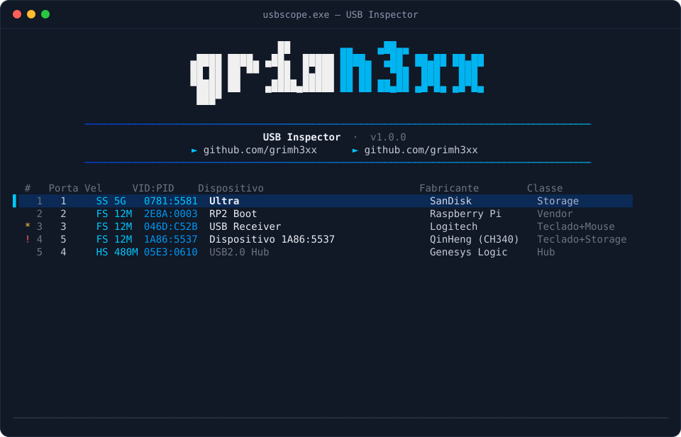</a>

<b>▶ More demos:</b> samcli · aircrackwin-x64

 

  <a href="https://github.com/grimh3xx/samcli-win-x64">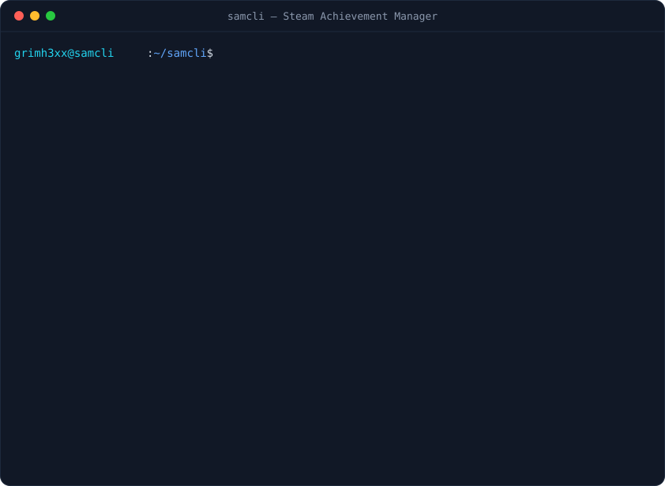</a>

  <a href="https://github.com/grimh3xx/aircracking-win-x64">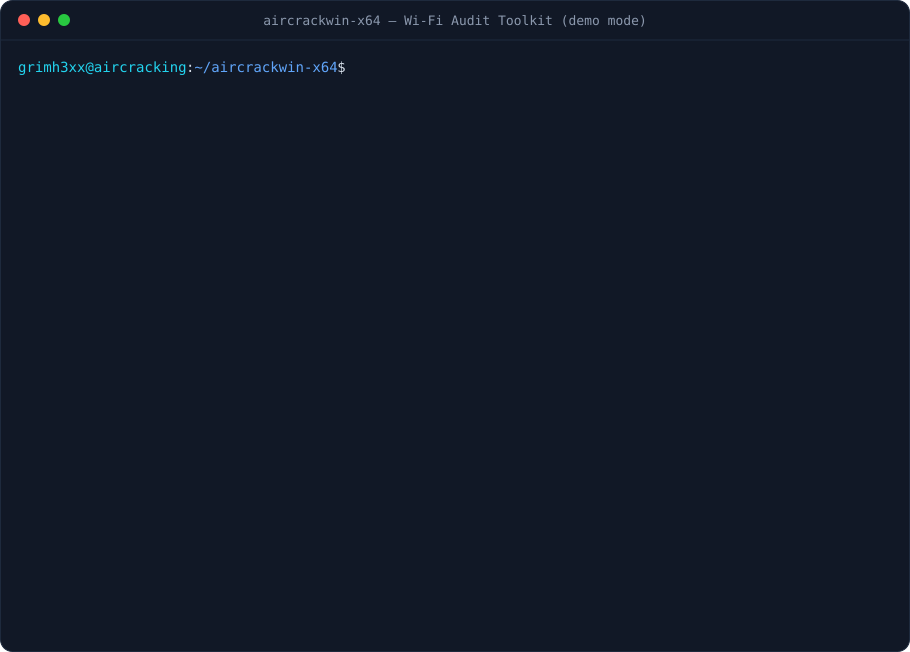</a>
   Demo mode with simulated networks. Only audit networks you own or have written permission to test.

## $ ls ~/projects --featured

  <a href="https://github.com/grimh3xx/usbscope"><picture><source media="(prefers-color-scheme: light)" srcset="assets/card-usbscope-light.svg"/>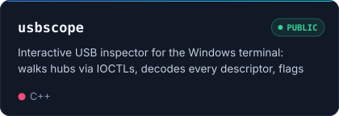</picture></a>
  <a href="https://github.com/grimh3xx/samcli-win-x64"><picture><source media="(prefers-color-scheme: light)" srcset="assets/card-samcli-light.svg"/>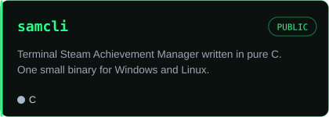</picture></a>
  <a href="https://github.com/grimh3xx/aircracking-win-x64"><picture><source media="(prefers-color-scheme: light)" srcset="assets/card-aircrack-light.svg"/>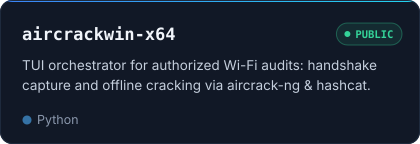</picture></a>
  <a href="https://github.com/grimh3xx/SecureArchSetup"><picture><source media="(prefers-color-scheme: light)" srcset="assets/card-securearch-light.svg"/>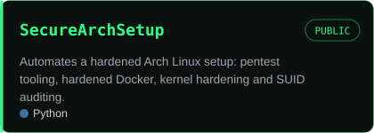</picture></a>
  <a href="https://github.com/grimh3xx/ExifTracer"><picture><source media="(prefers-color-scheme: light)" srcset="assets/card-exiftracer-light.svg"/>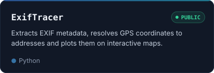</picture></a>

## $ ls ~/projects --in-progress

  <picture><source media="(prefers-color-scheme: light)" srcset="assets/card-netsentry-light.svg"/>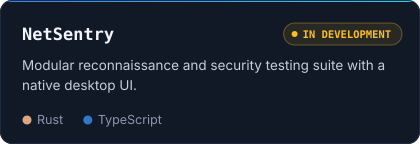</picture>
  <picture><source media="(prefers-color-scheme: light)" srcset="assets/card-aegis-light.svg"/>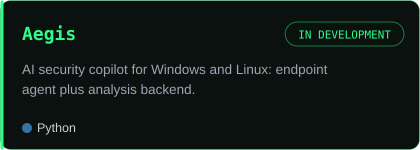</picture>
  <picture><source media="(prefers-color-scheme: light)" srcset="assets/card-winforge-light.svg"/>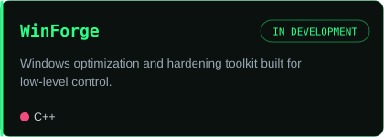</picture>
  <picture><source media="(prefers-color-scheme: light)" srcset="assets/card-cts-light.svg"/>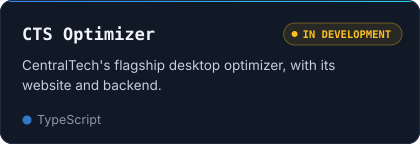</picture>

## $ cat certifications.txt

  <picture><source media="(prefers-color-scheme: light)" srcset="assets/cert-light.svg"/>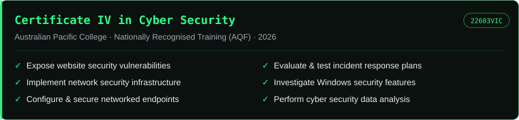</picture>

## $ cat skills.txt

<table>
<tr><td><b>Offensive Security</b></td><td>        </td></tr>
<tr><td><b>Languages</b></td><td>        </td></tr>
<tr><td><b>Systems & Hardware</b></td><td>      </td></tr>
<tr><td><b>Tools</b></td><td>      </td></tr>
<tr><td><b>Learning</b></td><td> </td></tr>
</table>

## $ github --activity

  <picture>
    <source media="(prefers-color-scheme: light)" srcset="profile-3d-contrib/profile-green-animate.svg"/>
    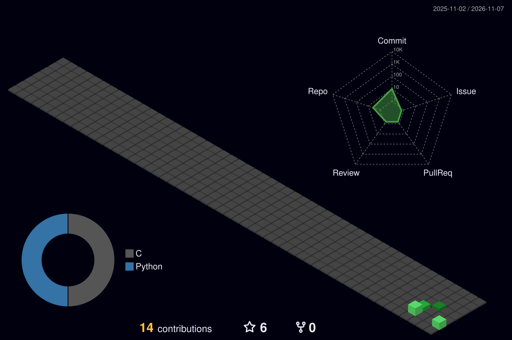
  </picture>

  <picture><source media="(prefers-color-scheme: light)" srcset="assets/stats-light.svg"/>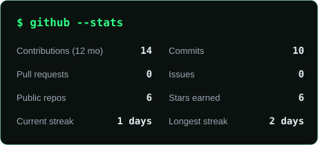</picture>
  <picture><source media="(prefers-color-scheme: light)" srcset="assets/langs-light.svg"/>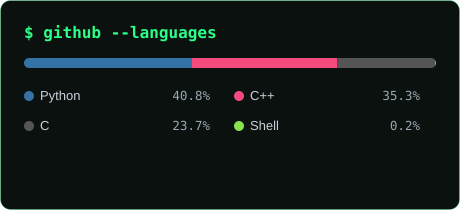</picture>

**Recent activity**

<!--ACTIVITY:START-->
- 🔓 Open-sourced [**aircracking-win-x64**](https://github.com/grimh3xx/aircracking-win-x64) · 21 days ago
- 🔓 Open-sourced [**usbscope**](https://github.com/grimh3xx/usbscope) · 21 days ago
- 🔓 Open-sourced [**samcli-win-x64**](https://github.com/grimh3xx/samcli-win-x64) · 21 days ago
- 🔓 Open-sourced [**ExifTracer**](https://github.com/grimh3xx/ExifTracer) · 14 months ago
<!--ACTIVITY:END-->

<code>// authorized testing only · break things responsibly</code>

